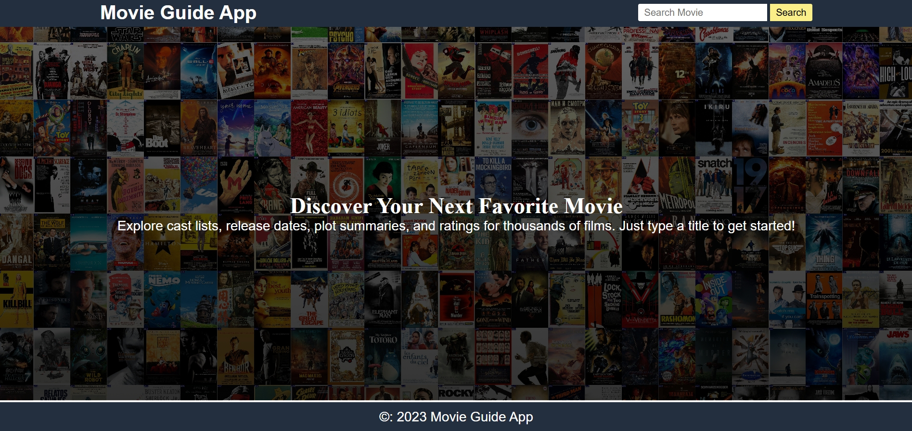
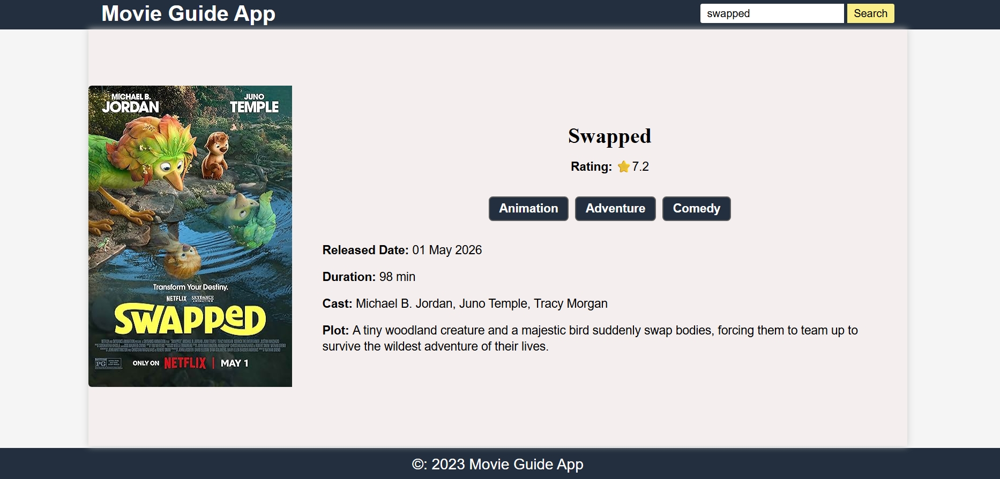
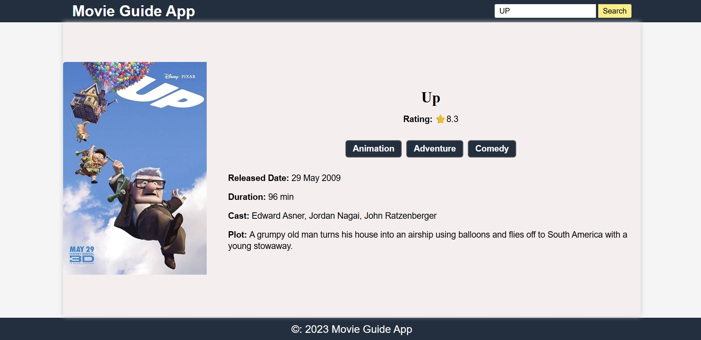
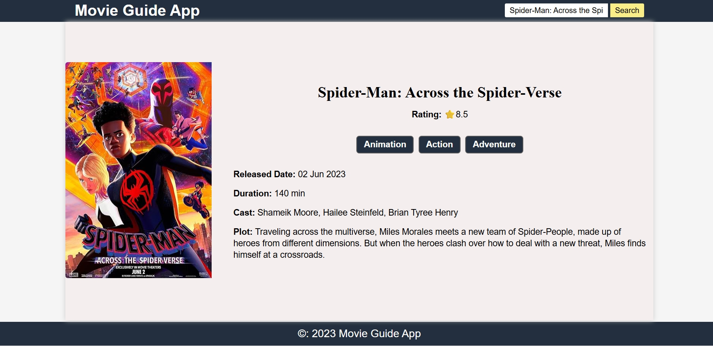
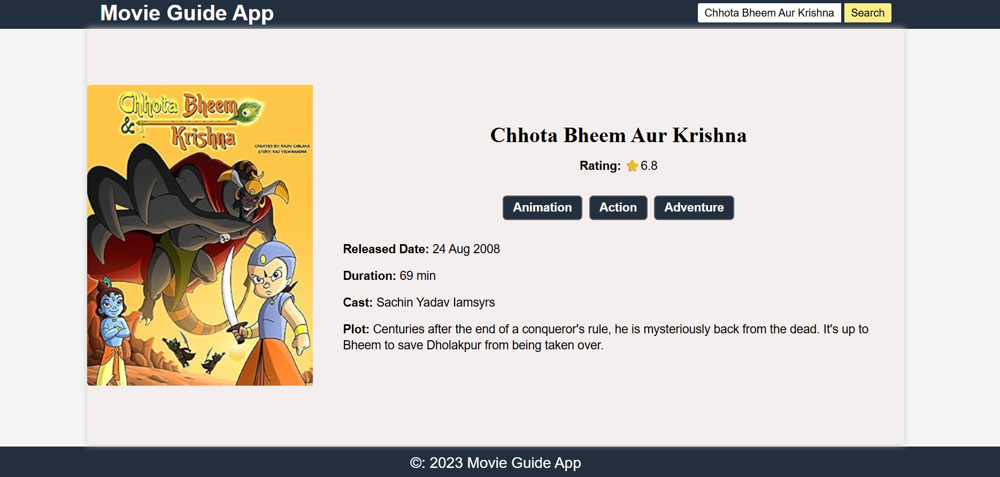

<h1 align="center"> Movie Search App </h1>
A simple and interactive movie search application that lets users search for their favorite movies and explore essential information, including ratings, genres, release dates, runtime, cast, plot, and posters.
<table align="center">
  <tr>
    <td></td>
      
    <td></td>
  </tr>
</table>

<h2> Features</h2>

<ul>
  <li>Search Movies — Search for movies by entering their names </li>
  <li>IMDb Ratings — View movie ratings at a glance. </li>
  <li>Movie Genres — Explore the different genres of each movie. </li>
  <li>Release Date — Check when a movie was released.</li>
  <li>Runtime — See the duration of a movie. </li>
  <li> Cast Information — Discover the actors featured in a movie. </li>
  <li> Movie Plot — Read a short description of the movie. </li>
  <li> Movie Posters — View the poster associated with each movie. </li>
  <li> API Integration — Fetch movie information dynamically from a movie database API. </li>
</ul>

<h2> Built With</h2>

<table>
  <tr>
    <td><strong>HTML5</strong></td>
    <td> Structures the web page and movie information.</td>
  </tr>
  <tr>
    <td><strong>CSS3</strong></td>
    <td>Styles the interface and movie display. </td>
  </tr>
  <tr>
    <td><strong>JavaScript</strong></td>
    <td>Handles search events, processes API data, and dynamically displays movie details. </td>
  </tr>
  <tr>
    <td><strong>Movie Database API</strong></td>
    <td>Retrieves movie information and poster images. </td>
  </tr>
</table>

<h2> Screenshots</h2>

  

  

  

